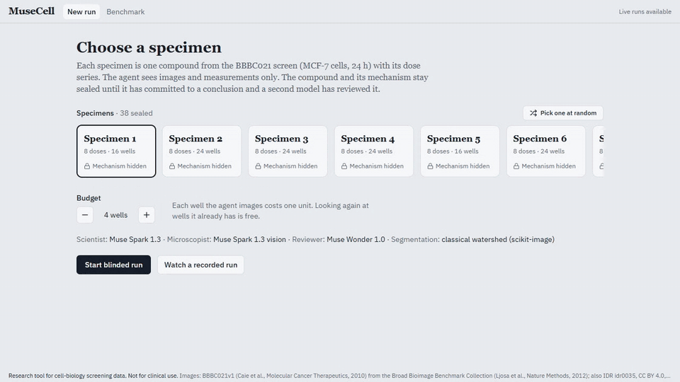
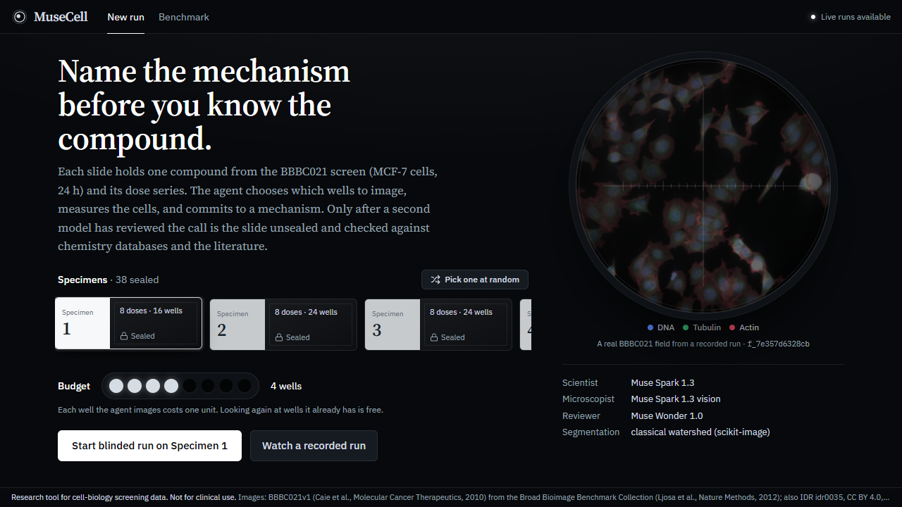
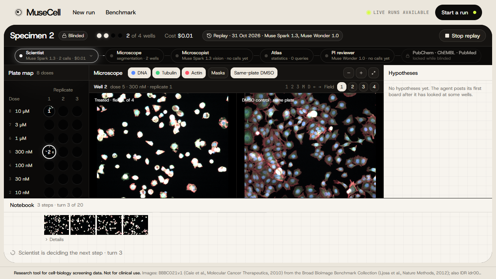
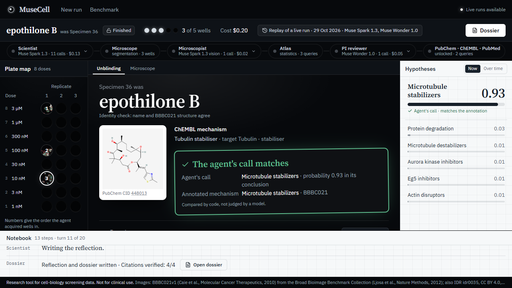
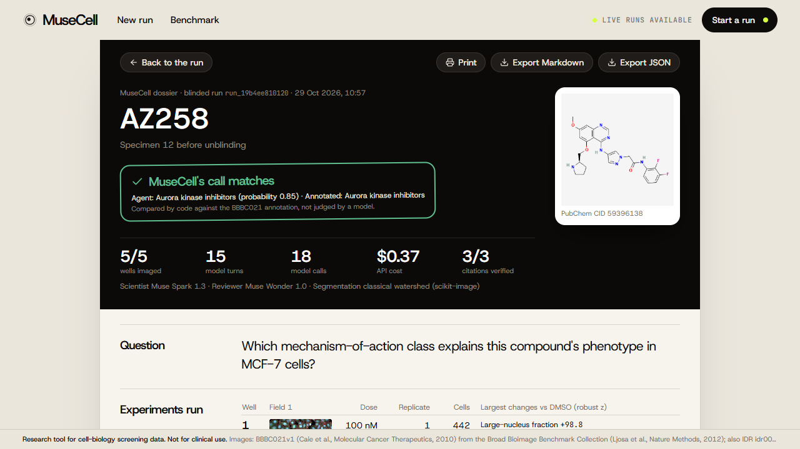
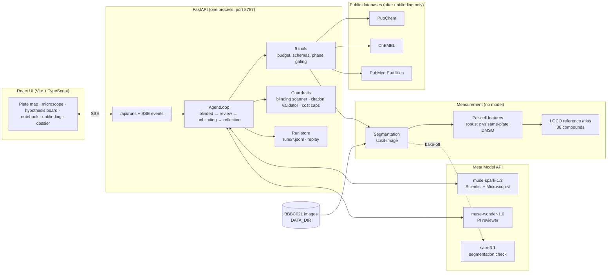

# MuseCell

> **TL;DR**
> 1. **What:** a blinded screening agent on real BBBC021 cell images. Muse Spark plans which 4 of ~24 wells to image, Muse Wonder reviews the call, and only then is the compound unblinded and checked against PubChem, ChEMBL and PubMed.
> 2. **Result:** right mechanism for **34/38** compounds; on the held-out half of a frozen split, **17/19**. The Scientist chooses the wells and the published NSC protocol makes the call. A fixed "4 highest doses" rule also gets 34/38, so the model's measured value is not extra accuracy. It is the blinded, audited record: why each well, the reviewer's critique, and a dossier with verified citations. [Benchmark](eval/RESULTS.md).
> 3. **Cost:** about $0.30 and 2 minutes per run on open weights (agent v5), $0.20–0.55 on full-price Muse Spark 1.3. **[Live demo](https://aleksandrahodzzik.github.io/musecell/)** · Video: *link added at submission*.

**MuseCell is an autonomous screening scientist.** Give it a blinded compound and a small budget of microscope wells. It images real cells, measures them, forms mechanism-of-action hypotheses, chooses the next experiment that best separates them, has its conclusion reviewed by a second model, and only then unblinds the compound and checks itself against chemistry databases and literature.

**▶ Live demo: https://aleksandrahodzzik.github.io/musecell/** · replays of recorded live runs in your browser, the benchmark and the dossiers; no install, no key. Live runs need the [Quickstart](#quickstart).

*Research tool for cell-biology screening data. Not for clinical use.*



<sub>Replay of a recorded live run (`run_19b4ee810120`, Muse Spark 1.3 + Muse Wonder 1.0, 5 wells, $0.37, 29 Oct), sped up 6×. It was recorded with **agent v1**: hand-crafted atlas, and the Scientist's own conclusion is the final call. The benchmark headline is agent v5 (deep atlas, protocol call). Replays are labelled as such in the app.</sub>

## Why this matters

Phenotypic drug screens treat cells with thousands of compounds and image them. They find hits that target-based screens miss, but the slow part comes after: working out **how** a hit acts (mechanism of action, "MoA deconvolution"). Today a biologist compares images with reference compounds, orders follow-up doses, and reads the literature. MuseCell runs that loop end to end and **decides which experiment to run next** instead of labelling one picture. It does so under a blinded protocol: the agent commits to a call before it can see the compound's name, and code scores the call afterwards.

Users are screening and computational biologists working with cell lines and small molecules. MuseCell never outputs diagnoses or treatment advice.

## How it uses Meta AI

Three Meta models play different roles in one run; every call is metered and capped. Which model produced which number: the **benchmark headline (agent v5) ran on Muse Spark Open via Baseten** with `muse-wonder-1.0` reviewing; the **recorded demo runs** are four on full-price `muse-spark-1.3` and one on Muse Spark Open, all agent v1; the **live app** defaults to `muse-spark-1.3` with agent v5, which has not been benchmarked on all 38 compounds.

| Role | Model | What it does | Code |
|---|---|---|---|
| Scientist agent | `muse-spark-1.3` | Tool-calling loop over 9 strict-schema tools: plans which wells to image, reads the measurements, keeps a hypothesis board, submits a blinded conclusion, then writes the reflection | [`agent/loop.py#L166`](backend/app/agent/loop.py#L166), [`agent/tools.py#L135`](backend/app/agent/tools.py#L135) |
| Microscopist | `muse-spark-1.3` (vision) | Looks at the treated composite + per-channel images next to a same-plate DMSO control, gets our measured top-deviating features, and returns a strict-schema morphology description that says which findings agree with the numbers | [`agent/tools.py#L337`](backend/app/agent/tools.py#L337), [`agent/microscopist.py`](backend/app/agent/microscopist.py) |
| PI reviewer | `muse-wonder-1.0` | Reads the blinded evidence ledger and the conclusion; approves or requests one more experiment (one revision round) | [`agent/reviewer.py#L66`](backend/app/agent/reviewer.py#L66), [`agent/loop.py#L226`](backend/app/agent/loop.py#L226) |
| Open weights (optional) | `meta-models/muse-spark-open-1026` on Baseten | Same Scientist + Microscopist on Meta's open-weights Muse Spark Open; the reviewer and SAM stay on the Meta API. See [Runs on Meta open weights](#runs-on-meta-open-weights) | [`config.py`](backend/app/config.py), [`llm.py`](backend/app/llm.py) |
| Segmenter | `sam-3.1` | Benchmarked against classical segmentation and used as an independent check of the classical nuclei (median IoU 0.85 on DMSO tiles). Classical segmentation won the bake-off on full fields, so it produces the masks; SAM stays selectable with `NUCLEI_SEGMENTER=sam` | [`sam.py`](backend/app/sam.py), [`scripts/segmentation_bakeoff.py`](scripts/segmentation_bakeoff.py), [`docs/DECISIONS.md`](docs/DECISIONS.md) |

One client, [`LLMClient`](backend/app/llm.py#L175), talks to `https://api.meta.ai/v1`. At startup it calls `GET /v1/models` and refuses to start with a model id that does not exist ([`check_models`](backend/app/llm.py#L198)). It retries on 429/5xx, counts tokens, prices every call, and enforces a per-run and a daily cost cap ([`llm.py#L218`](backend/app/llm.py#L218)).

## What you see

| | |
|---|---|
|  |  |
| **Start.** A real BBBC021 field in the eyepiece (toggle the stains, pan with the pointer); specimens are sealed slides; the budget is a row of wells. | **Run.** The agent circuit lights the model working right now. Wells fill with their own fields; the microscope sits beside the same-plate DMSO control. |
|  |  |
| **Unblinding.** The name resolves, the structure and ChEMBL mechanism appear, and code stamps the verdict. | **Dossier.** Printable report with experiments, hypothesis history, review, reflection and verified citations; export Markdown or JSON. |

Things to try in a replay:
- Click a node of the **agent circuit** (Scientist, Microscopist, PI reviewer) for its per-call ledger: tokens in and out, reasoning tokens, seconds and cost of every Meta model call.
- Switch the hypothesis board to **Over time** and scrub through the agent's board updates.
- In the microscope: **1 2 3** toggle stains, **M** cell masks with hover measurements, **D** the same-plate DMSO control, **← →** fields, **+ −** zoom.

## Architecture



A run: the Scientist spends its well budget with `acquire_well` (a virtual microscope over real BBBC021 images), looks with `describe_phenotype`, compares with `compare_to_reference_atlas` and `dose_response`, updates its hypotheses, and calls `submit_conclusion`. The reviewer approves or asks for one more experiment. Only then do `lookup_compound` and `search_literature` unlock; code computes the verdict ([`loop.py#L263`](backend/app/agent/loop.py#L263)), and the agent writes a reflection and a dossier (Markdown + JSON) that cites only papers it actually retrieved.

Layout: `backend/app/agent` (loop, tools, reviewer, guardrails), `backend/app/science` (segmentation, features, atlas, stats), `backend/app/external` (PubChem, ChEMBL, PubMed clients), `backend/app/runs` (event store, replay), `frontend/` (UI), `scripts/` (data pipeline, eval, demo recording), `demo/` (5 recorded runs + 40 thumbnails), `eval/` (benchmark results).

## Quickstart

### Replay mode — no API key, no data download (Windows PowerShell)

Needs Python 3.12 and Node 18+ (tested with Node 24).

```powershell
git clone https://github.com/aleksandrahodzzik/musecell.git; cd musecell
py -3.12 -m venv .venv
.\.venv\Scripts\Activate.ps1          # if blocked: Set-ExecutionPolicy -Scope CurrentUser RemoteSigned
python -m pip install -r backend/requirements.txt
cd frontend; npm ci; npm run build; cd ..
python -m uvicorn app.main:app --app-dir backend --port 8787
```

Open http://127.0.0.1:8787, choose **Watch a recorded run**, and pick one of the five recorded runs (one of them on open weights; all five were recorded with agent v1). Without a key and data the app says that live runs are off; replays, dossiers and the benchmark page work. Cell masks and hover measurements need the data.

macOS / Linux: the same, with `python3.12 -m venv .venv`, `source .venv/bin/activate`, and `&&` or new lines instead of `;`.

### Live mode — with a Meta Model API key

```powershell
Copy-Item .env.example backend/.env   # fill in MODEL_API_KEY, NCBI_EMAIL, DATA_DIR (outside the repo)
python scripts/probe_meta_api.py      # checks the key and the model ids
python scripts/fetch_bbbc021.py       # prints the download plan (~10.8 GB of HTTP range reads); downloads nothing
python scripts/fetch_bbbc021.py fetch # downloads the planned TIFFs (resumable)
python scripts/preprocess.py
python scripts/build_atlas.py         # segmentation + features for 3,096 fields (~30 min with 10 workers)
# optional, for the deep atlas (agent v4; without it the app falls back to the hand-crafted atlas):
python -m pip install -r backend/requirements-ml.txt --index-url https://download.pytorch.org/whl/cpu
python scripts/embed_fields.py        # ResNet50 embeddings, ~40 min on 12 CPU threads
python scripts/build_deep_atlas.py
python -m uvicorn app.main:app --app-dir backend --port 8787
```

Then **Start blinded run** in the UI, or `python scripts/run_agent_cli.py --list` and `--specimen <id>` in the terminal. A full-price run costs about $0.20–0.55 (the four demo runs). Development: `npm run dev` in `frontend/` serves on port 5174 with `/api` proxied to 8787.

## Evaluation

`scripts/evaluate.py` runs the full agent (blinded loop, review, unblinding, literature, reflection) on all 38 MoA-annotated BBBC021 compounds, leave-one-compound-out, and compares it with the nearest-neighbour (NSC) protocol. All numbers are from [`eval/RESULTS.md`](eval/RESULTS.md), which the script writes.

**Current agent (v5), Muse Spark Open on Baseten, 4 wells per compound:**

| | Accuracy |
|---|---|
| **MuseCell (v5)**: final call from the 4 wells the agent chose | **89.5% (34/38)**. Held-out test half: **17/19** |
| Fixed rule, no model: the 4 highest doses, same vote | 89.5% (34/38). Held-out test half: 18/19 |
| NSC on 4 random wells (same features) | 81.3% (sd 4.9 over draws) |
| NSC on all ~24 wells of the compound | 92.1% (35/38) |
| The Scientist's own conclusion, same runs | 79.0% (30/38) |

**How the roles are split, and why.** The Scientist (Muse Spark) plans the experiment: which 4 of about 24 wells to image, at which doses, and why. It also argues its case to the PI reviewer (Muse Wonder) and explains the result. The final call is the NSC vote over exactly the wells it chose. We chose this split from evidence:
- In agent v4, the vote on the agent's own wells was right for 35/38 compounds. When the Scientist overrode it, it was right 1 time in 7.
- On the dev half that was 0 of 5. Each time the Scientist pulled toward visually striking classes (stabilizers, Aurora kinases).
- So the language model's lever on accuracy is **which wells to image**. From 4 agent-chosen wells, MuseCell gets within one compound of imaging every well.
- **But a fixed rule does as well.** Scored with the same vote function on the same compounds ([`scripts/well_choice.py`](scripts/well_choice.py)), "the 4 highest doses" gets 34/38, and 114 of the agent's 152 wells were among those doses. Agent minus that rule: +0.0 points, paired bootstrap 95% interval −10.5 to +10.5. Agent minus 4 random wells: +8.3 points, interval −0.2 to +16.9. The rule was picked as the best of five after seeing all 38 compounds, which favours the rule. So on this dataset the agent's well choice is **not distinguishable from a simple rule**. What the agent adds is the blinded, audited record: why each well, the reviewer's critique, the explanation and a dossier whose citations were all retrieved in the run. The full table, by dev and test half, is in [`eval/RESULTS.md`](eval/RESULTS.md).
- The Scientist's own call is still recorded, scored and shown next to the final call ("agrees" / "dissents").

0 failed runs, 0 blinding leaks in the offline re-scan, 117/117 cited PMIDs retrieved in-run.

**How it got here** (every version stays in [`eval/agent_runs.jsonl`](eval/agent_runs.jsonl)):

| Agent, budget 4 | Atlas features | Final call | Accuracy | NSC baseline, 4 random wells (± = sd over draws) |
|---|---|---|---|---|
| v1, `muse-spark-1.3-contributor` | hand-crafted (24 features) | Scientist | 36.8% | 57.8% ± 5.8 |
| v1, Muse Spark Open (Baseten) | hand-crafted | Scientist | 44.7% | 57.8% ± 5.8 |
| v3, Muse Spark Open | hand-crafted | Scientist | 55.3% | 57.8% ± 5.8 |
| v4, Muse Spark Open | ResNet50 (ImageNet) + TVN | Scientist | 79.0% | 81.3% ± 4.9 |
| **v5, Muse Spark Open** | ResNet50 (ImageNet) + TVN | **NSC vote over the agent's wells** | **89.5%** | 81.3% ± 4.9 |

- **v1 → v3** (prompt and tool changes):
  - [`scripts/nsc_on_agent_wells.py`](scripts/nsc_on_agent_wells.py) showed that the agent picked informative wells but lost the answer.
  - The atlas tool now returns the NSC vote over all acquired wells.
  - The blinded phase names no compound.
- **v3 → v4** (better measurements, for similarity search only):
  - The atlas searches ImageNet-pretrained ResNet50 embeddings of each stain ([`scripts/embed_fields.py`](scripts/embed_fields.py)), whitened against DMSO wells (Typical Variation Normalization, [`scripts/build_deep_atlas.py`](scripts/build_deep_atlas.py)).
  - No MoA label is used to build them. The agent still reads the measured, interpretable features.
- **v4 → v5** (the role split above, decided on dev-half evidence):
  - The reviewer now sees the vote and can ask for the well that resolves a split.
- **Held-out check.** A dev/test split was frozen before v4 was explored ([`eval/split.json`](eval/split.json)), and v4 and v5 were decided on dev evidence. The test half was then looked at once for each (v4 17/19, v5 17/19).
- **Caveat.** v1–v3 were developed on all 38 compounds, and BBBC021 has no other annotated compounds. Treat the overall numbers as development results and the test-half numbers as the cleaner estimate.

Rebuild everything from the log without API calls (needs the data and the run logs):

```powershell
python scripts/evaluate.py --model meta-models/muse-spark-open-1026@v5 --compare meta-models/muse-spark-open-1026@v4 meta-models/muse-spark-open-1026@v3 meta-models/muse-spark-open-1026 muse-spark-1.3-contributor --aggregate-only
```

## Runs on Meta open weights

The same agent runs on **Muse Spark Open**, Meta's open-weights model, served by **Baseten**: model id `meta-models/muse-spark-open-1026` at `https://inference.baseten.co/v1` (OpenAI-compatible). In open-weights mode the Scientist, the Microscopist and the reflection run on Muse Spark Open. The PI reviewer stays `muse-wonder-1.0` and SAM stays `sam-3.1` on the Meta Model API, so a run uses both providers. The UI says so: the start screen has a **Models** switch (Meta Model API / Open weights); the run header, recorded-runs list and dossier carry an **"Open weights · Muse Spark Open via Baseten"** badge; and the agent circuit names the provider of each model.

Nothing in the agent loop is forked. [`LLMClient`](backend/app/llm.py) routes each call by model id ([`provider_of`](backend/app/config.py)), checks `GET /v1/models` on both providers at startup, and meters every call (Baseten list price $1.25 / $4.25 per 1M tokens, paid from hackathon credits, logged as `credits`). [`scripts/probe_baseten.py`](scripts/probe_baseten.py) found that strict tool schemas, parallel tool calls and strict `json_schema` output all work and are enforced. It also found two limits: reasoning is always on (returned in `reasoning_content`), and a request can carry at most 8 images. For that limit, the Microscopist sends composites only when the per-channel images would exceed 8. Details are in [docs/DECISIONS.md](docs/DECISIONS.md) ("Stretch").

Same 38 compounds, budget 4, same tools and same PI reviewer, from [`eval/RESULTS.md`](eval/RESULTS.md):

| | Muse Spark 1.3 (contributor tier), Meta API, agent v1 | Muse Spark Open (Baseten), agent v1 | Muse Spark Open (Baseten), agent v3 | NSC baseline, 4 random wells |
|---|---|---|---|---|
| Accuracy | 36.8% (14/38) | 44.7% (17/38) | **55.3% (21/38)** | 57.8% ± 5.8 |
| Before PI review | 36.8% | 31.6% | 50.0% | – |
| Failed runs | 0 | 3 (1 before a conclusion; 2 in the reflection, after the verdict) | 1 (blinding guard) | – |
| Mean latency | 208 s | 167 s | 142 s | – |
| Citations verified | 109/109 | 111/112 | 128/129 | – |

With agent v1 on open weights the PI reviewer turned 5 wrong calls into right ones and no right call into a wrong one; with v3, 3 and 1. Both are still below the NSC baseline, and with 38 compounds a 3-compound difference is within noise (v3 caveat above: designed on these compounds). It shares the over-call of "Microtubule stabilizers" (11 of 38 calls, 3 true). Mean cost was $0.365 per run at Baseten list price plus the reviewer. That is not comparable with the contributor tier, which is priced 10–20× lower.

With the deep atlas and the protocol call (agent v5) the same open model reaches **89.5% (34/38)**; see [Evaluation](#evaluation).

One recorded demo run is on open weights: `run_2bee8860f390` (epothilone B, correct, reviewer approved, citations 5/5).

Reproduce (needs `MODEL_API_KEY` for the reviewer and `BASETEN_API_KEY`, both in `backend/.env`):

```powershell
python scripts/probe_baseten.py                                   # PASS/FAIL per capability, writes docs/probe/baseten_probe.json
$env:PROVIDER="baseten"; python scripts/run_agent_cli.py --specimen s_89c9462717 --budget 4; Remove-Item Env:PROVIDER
python scripts/evaluate.py --provider baseten --budgets 4 --model muse-spark-1.3-contributor        # estimate only
python scripts/evaluate.py --provider baseten --budgets 4 --model muse-spark-1.3-contributor --yes  # 38 runs
python scripts/evaluate.py --model muse-spark-1.3-contributor --compare meta-models/muse-spark-open-1026 meta-models/muse-spark-open-1026@v3 --aggregate-only
```

Or set `PROVIDER=baseten` in `backend/.env` to make open weights the default; with only `BASETEN_API_KEY` added, the start screen offers the switch per run.

## Guardrails

- **Blinding.** Specimens, wells and fields carry salted opaque ids. During a blinded run a scanner checks every event and every message sent to a model for the compound's name, PubChem synonyms, SMILES and plate/well names, and stops the run before a leak reaches the model or the browser ([`BlindingScanner`](backend/app/agent/guardrails.py#L145)). The database and literature tools unlock only after the conclusion. Tests: [`test_tools.py#L279`](backend/tests/test_tools.py#L279), [`test_loop.py#L209`](backend/tests/test_loop.py#L209), [`test_api.py#L85`](backend/tests/test_api.py#L85). In the eval the guard stopped one run; an offline re-scan of all 114 logs found 0 leaks.
- **Citations.** The reflection and dossier may cite only PMIDs that `search_literature` returned in the same run; anything else is stripped and the UI shows "Citations verified: n/n" ([`validate_citations`](backend/app/agent/guardrails.py#L102)).
- **Verdict by code.** Right or wrong is the final call (from agent v5, the NSC vote over the agent's wells; before that, the Scientist's top MoA) compared with the BBBC021 annotation, never a model's judgement. The Scientist's own call is scored separately.
- **Budget and turns.** Wells are counted server-side (max 8), max 20 model turns per run, strict JSON schemas with Pydantic validation; a tool error is shown to the agent, not hidden.
- **Cost caps.** Per-run cap (default $1.00) and daily cap (default $20) checked before every call; the daily ledger survives restarts. Models without a price are refused.
- **No canned output.** A failed model call is a visible error event. Replays are real recorded runs and carry a permanent "Replay of a live run · date · models" badge.

## Data

Images: BBBC021v1 [Caie et al., *Molecular Cancer Therapeutics*, 2010], from the Broad Bioimage Benchmark Collection [Ljosa et al., *Nature Methods*, 2012]; also distributed as IDR idr0035 under CC BY 4.0. Images © AstraZeneca. MCF-7 breast cancer cells, 3 stains (DNA, β-tubulin, F-actin). Raw TIFFs are not in this repository; `demo/thumbnails/` holds 40 downscaled derivatives under the same license. Details: [DATA_LICENSE.md](DATA_LICENSE.md).

Compound identity and mechanisms after unblinding come from [PubChem](https://pubchem.ncbi.nlm.nih.gov/) and [ChEMBL](https://www.ebi.ac.uk/chembl/); literature from [PubMed](https://pubmed.ncbi.nlm.nih.gov/) via NCBI E-utilities.

## Limitations

- **One cell line, one dataset.** MCF-7 cells, 38 annotated compounds in 12 MoA classes, a single public screen. Nothing here has been tested on other cell lines, stains or plates.
- **The virtual microscope replays existing images.** "Acquiring a well" reads a well that was imaged in 2010; the agent chooses among doses and replicates that already exist and cannot order a new experiment.
- **Features.** The agent reads hand-built per-cell features (intensity, shape, GLCM texture) from classical segmentation; similarity search uses ImageNet ResNet50 embeddings, not a model trained on cells. Classical cell bodies have no independent check; SAM 3.1 was used to check nuclei only.
- **The language model does not add accuracy here.** The Scientist alone reaches 79.0%. MuseCell's 89.5% comes from the Scientist choosing the wells and the NSC protocol making the call, and a fixed "4 highest doses" rule reaches the same 89.5%. v1–v5 were developed on these 38 compounds; v4/v5 have a held-out check on the test half of a frozen split (17/19 each), which is still only 19 compounds. Full-price `muse-spark-1.3` with agent v5 was not benchmarked.
- **Small eval.** 38 compounds is small, so differences of a few compounds are within noise (see the bootstrap intervals). The 38 compounds are the only annotated set: v1–v3 were tuned on all of them, and v4/v5 on the dev half of a split frozen before v4.
- **Demo vs benchmark.** The recorded replays and the hero GIF are agent v1 runs from 29 October; the benchmark headline is agent v5.
- **Replay without data.** In a fresh clone without `DATA_DIR`, masks, hover measurements and fields beyond the 40 shipped thumbnails are unavailable (the UI says so).

## Built during the hackathon

Built during the Meta AI Developer Hackathon (Oct 26 – Nov 4, 2026). All code, data processing, evaluation and recordings in this repository were made in that window; the commit history shows each phase (skeleton, data, science, agent, UI, eval, release). Decisions, surprises and measured costs are logged in [docs/DECISIONS.md](docs/DECISIONS.md); the spec is [docs/MASTER_SPEC.md](docs/MASTER_SPEC.md); screenshots are in [docs/screens/](docs/screens/).

## License

Code: MIT ([LICENSE](LICENSE)). Data: see [DATA_LICENSE.md](DATA_LICENSE.md).

*Research tool for cell-biology screening data. Not for clinical use.*
