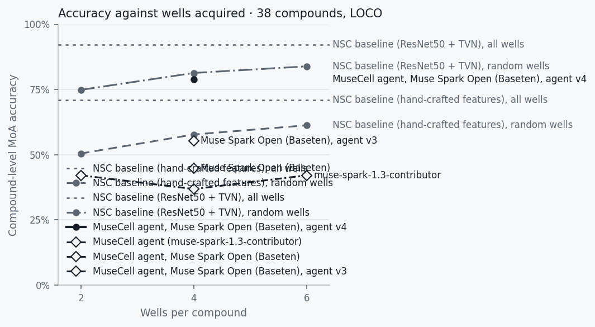

# MuseCell evaluation

Generated 2026-10-30T17:12:27+00:00 by `scripts/evaluate.py`. Numbers are written by the script, never edited by hand.

- Compounds: 38 MoA-annotated BBBC021 compounds, leave-one-compound-out (the atlas never contains the compound under test).
- Metric: compound-level MoA accuracy (one call per compound).
- Models: scientist `meta-models/muse-spark-open-1026`, microscopist `meta-models/muse-spark-open-1026`, reviewer `muse-wonder-1.0`, segmentation `classical (scikit-image)`.
- Blinding-leak test: pytest leak/blinding tests: 13 passed, 88 deselected in 9.12s; offline re-scan of 38 eval run logs (events before unblinding): 0 hits

| Method | Wells / compound | Accuracy | Correct | Before review | Mean wells used | Mean cost | Mean latency | Citations verified |
|---|---|---|---|---|---|---|---|---|
| NSC baseline (hand-crafted features), all wells | all | 71.0% | 27/38 | – | – | – | – | – |
| NSC baseline (hand-crafted features), random wells | 2 | 50.5% ± 6.2 | – | – | 2.00 | – | – | – |
| NSC baseline (hand-crafted features), random wells | 4 | 57.8% ± 5.8 | – | – | 4.00 | – | – | – |
| NSC baseline (hand-crafted features), random wells | 6 | 61.3% ± 5.0 | – | – | 6.00 | – | – | – |
| NSC baseline (ResNet50 + TVN), all wells | all | 92.1% | 35/38 | – | – | – | – | – |
| NSC baseline (ResNet50 + TVN), random wells | 2 | 74.9% ± 5.9 | – | – | 2.00 | – | – | – |
| NSC baseline (ResNet50 + TVN), random wells | 4 | 81.3% ± 4.9 | – | – | 4.00 | – | – | – |
| NSC baseline (ResNet50 + TVN), random wells | 6 | 83.9% ± 4.3 | – | – | 6.00 | – | – | – |
| MuseCell agent, Muse Spark Open (Baseten), agent v4 | 4 | 79.0% | 30/38 | 76.3% | 4.00 | $0.360 | 171 s | 116/116 (100.0%) |
| MuseCell agent (muse-spark-1.3-contributor) | 2 | 42.1% | 16/38 | 36.8% | 2.00 | $0.107 | 203 s | 103/103 (100.0%) |
| MuseCell agent (muse-spark-1.3-contributor) | 4 | 36.8% | 14/38 | 36.8% | 3.92 | $0.135 | 208 s | 109/109 (100.0%) |
| MuseCell agent (muse-spark-1.3-contributor) | 6 | 42.1% | 16/38 | 42.1% | 5.61 | $0.143 | 239 s | 108/108 (100.0%) |
| MuseCell agent, Muse Spark Open (Baseten) | 4 | 44.7% | 17/38 | 31.6% | 3.97 | $0.365 | 167 s | 111/112 (99.1%) |
| MuseCell agent, Muse Spark Open (Baseten), agent v3 | 4 | 55.3% | 21/38 | 50.0% | 4.00 | $0.375 | 142 s | 128/129 (99.2%) |

± = standard deviation over random well draws. "Before review" = the agent's first conclusion, before the PI reviewer's critique and any requested experiment.

## Agents side by side, budget 2

Same 38 compounds, same tools, same PI reviewer (`muse-wonder-1.0`, Meta API); the columns differ in the Scientist + Microscopist model, the agent version and the atlas features.

| | muse-spark-1.3-contributor | NSC baseline (hand-crafted features), random wells | NSC baseline (ResNet50 + TVN), random wells |
|---|---|---|---|
| Scientist model | `muse-spark-1.3-contributor` | – | – |
| Provider | Meta Model API | – | – |
| Atlas features | hand-crafted features | hand-crafted features | ResNet50 + TVN |
| Accuracy | 42.1% (16/38) | 50.5% ± 6.2 | 74.9% ± 5.9 |
| Before review | 36.8% | – | – |
| NSC on the wells the agent chose | 47.4% | – | – |
| Failed runs | 0 | – | – |
| Mean cost / run | $0.107 | – | – |
| Mean latency | 203 s | – | – |
| Citations verified | 103/103 | – | – |
| Reviewer requests | 15 | – | – |

Cost on open weights is nominal: Baseten list price ($1.25 / $4.25 per 1M tokens) for the Scientist/Microscopist tokens, paid from hackathon credits, plus the reviewer at Meta API prices.

## Agents side by side, budget 4

Same 38 compounds, same tools, same PI reviewer (`muse-wonder-1.0`, Meta API); the columns differ in the Scientist + Microscopist model, the agent version and the atlas features.

| | Muse Spark Open (Baseten), agent v4 | muse-spark-1.3-contributor | Muse Spark Open (Baseten) | Muse Spark Open (Baseten), agent v3 | NSC baseline (hand-crafted features), random wells | NSC baseline (ResNet50 + TVN), random wells |
|---|---|---|---|---|---|---|
| Scientist model | `meta-models/muse-spark-open-1026` | `muse-spark-1.3-contributor` | `meta-models/muse-spark-open-1026` | `meta-models/muse-spark-open-1026` | – | – |
| Provider | Baseten | Meta Model API | Baseten | Baseten | – | – |
| Atlas features | ResNet50 (ImageNet) + TVN | hand-crafted features | hand-crafted features | hand-crafted features | hand-crafted features | ResNet50 + TVN |
| Accuracy | 79.0% (30/38) | 36.8% (14/38) | 44.7% (17/38) | 55.3% (21/38) | 57.8% ± 5.8 | 81.3% ± 4.9 |
| Before review | 76.3% | 36.8% | 31.6% | 50.0% | – | – |
| NSC on the wells the agent chose | 92.1% | 60.5% | 60.5% | 63.2% | – | – |
| Failed runs | 0 | 0 | 3 | 1 | – | – |
| Mean cost / run | $0.360 (incl. credits) | $0.135 | $0.365 (incl. credits) | $0.375 (incl. credits) | – | – |
| Mean latency | 171 s | 208 s | 167 s | 142 s | – | – |
| Citations verified | 116/116 | 109/109 | 111/112 | 128/129 | – | – |
| Reviewer requests | 10 | 18 | 21 | 14 | – | – |

Cost on open weights is nominal: Baseten list price ($1.25 / $4.25 per 1M tokens) for the Scientist/Microscopist tokens, paid from hackathon credits, plus the reviewer at Meta API prices.

## Agents side by side, budget 6

Same 38 compounds, same tools, same PI reviewer (`muse-wonder-1.0`, Meta API); the columns differ in the Scientist + Microscopist model, the agent version and the atlas features.

| | muse-spark-1.3-contributor | NSC baseline (hand-crafted features), random wells | NSC baseline (ResNet50 + TVN), random wells |
|---|---|---|---|
| Scientist model | `muse-spark-1.3-contributor` | – | – |
| Provider | Meta Model API | – | – |
| Atlas features | hand-crafted features | hand-crafted features | ResNet50 + TVN |
| Accuracy | 42.1% (16/38) | 61.3% ± 5.0 | 83.9% ± 4.3 |
| Before review | 42.1% | – | – |
| NSC on the wells the agent chose | 63.2% | – | – |
| Failed runs | 2 | – | – |
| Mean cost / run | $0.143 | – | – |
| Mean latency | 239 s | – | – |
| Citations verified | 108/108 | – | – |
| Reviewer requests | 13 | – | – |

Cost on open weights is nominal: Baseten list price ($1.25 / $4.25 per 1M tokens) for the Scientist/Microscopist tokens, paid from hackathon credits, plus the reviewer at Meta API prices.

## Where the agent goes wrong

All 38 agent runs pooled over budgets (total API cost $13.68).

| Mechanism class | Agent calls | True runs | Correct |
|---|---|---|---|
| Microtubule stabilizers | 7 | 3 | 3/3 |
| Aurora kinase inhibitors | 5 | 3 | 3/3 |
| DNA damage | 4 | 4 | 4/4 |
| Microtubule destabilizers | 4 | 4 | 4/4 |
| DNA replication | 3 | 4 | 2/4 |
| Eg5 inhibitors | 3 | 2 | 2/2 |
| Epithelial | 3 | 3 | 3/3 |
| Kinase inhibitors | 3 | 3 | 3/3 |
| Protein synthesis | 3 | 3 | 3/3 |
| Protein degradation | 2 | 4 | 2/4 |
| Actin disruptors | 1 | 3 | 1/3 |
| Cholesterol-lowering | 0 | 2 | 0/2 |

PI review: 10 requests for another experiment, 28 approvals; the final call changed from wrong to right in 2 runs and from right to wrong in 1.

## Notes

- Eval runs used `muse-spark-1.3-contributor` (same model, cheaper tier that lets Meta train on prompts; allowed only because BBBC021 is public). The live app uses `muse-spark-1.3`.
- MuseCell agent, Muse Spark Open (Baseten), agent v4, budget 4: chosen on the dev half of a split frozen before it was explored (eval/split.json); dev 13/19, held-out test 17/19.
- Agent v2/v3 (the atlas tool also returns the NSC vote over the wells acquired so far, the prompt says how to weigh it, and the blinded phase names no compound) was designed after reading the v1 runs on these same 38 compounds (`scripts/nsc_on_agent_wells.py`). BBBC021 has no other annotated compounds, so v3 accuracy is not a held-out estimate. A v2 eval was stopped after 19 runs (11 correct, 2 stopped by the blinding guard) to add the naming rule; its runs stay in eval/agent_runs.jsonl.
- MuseCell agent (muse-spark-1.3-contributor), budget 6, s_89c9462717: run failed before a conclusion; counted as wrong: Blinding guard stopped the run: the result of describe_phenotype contained compound-identifying text.
- MuseCell agent (muse-spark-1.3-contributor), budget 6, s_3069b9414e: run failed before a conclusion; counted as wrong: muse-spark-1.3-contributor used all 8000 tokens (incl. 7998 reasoning) without answering. Raise max_tokens for this call.
- MuseCell agent, Muse Spark Open (Baseten), budget 4, s_14844eef0c: run failed before a conclusion; counted as wrong: meta-models/muse-spark-open-1026 used all 8000 tokens (incl. 7997 reasoning) without answering. Raise max_tokens for this call.
- MuseCell agent, Muse Spark Open (Baseten), budget 4, s_8dd1eb85a8: run failed after the verdict, which stands (right): meta-models/muse-spark-open-1026 returned invalid JSON for reflection: {
- MuseCell agent, Muse Spark Open (Baseten), budget 4, s_89e4b24a88: run failed after the verdict, which stands (right): meta-models/muse-spark-open-1026 returned invalid JSON for reflection: {
- MuseCell agent, Muse Spark Open (Baseten), agent v3, budget 4, s_89c9462717: run failed before a conclusion; counted as wrong: Blinding guard stopped the run: a 'review' event contained compound-identifying text.
- The random-well baseline votes over 1-NN calls of single wells; the all-wells baseline uses treatment profiles (median over replicates), the published NSC protocol.
